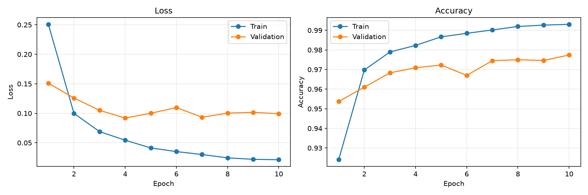
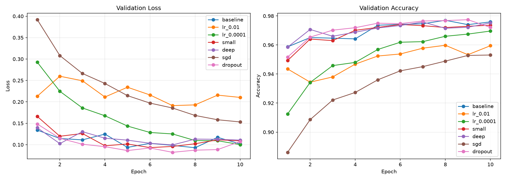
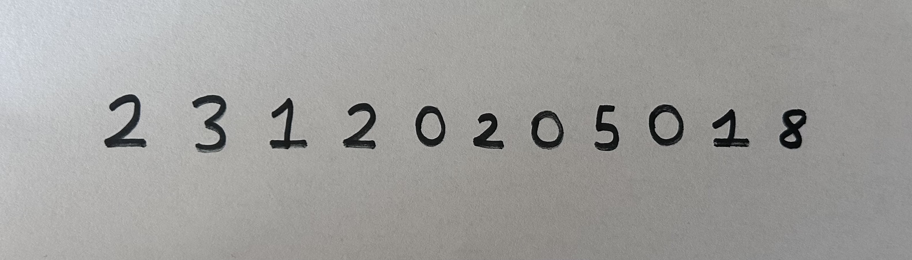
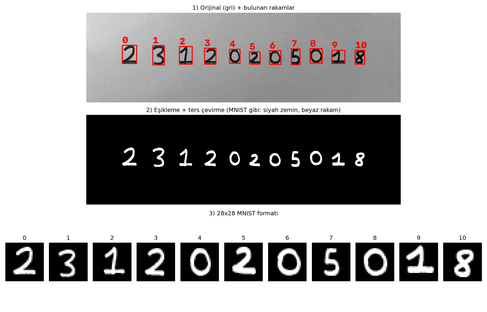
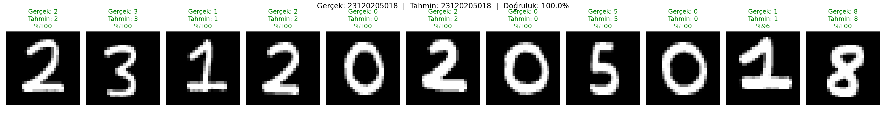

# MNIST Veri Seti ile MLP Tabanlı El Yazısı Rakam Tanıma

Bu projede MNIST el yazısı rakam veri seti kullanılarak **sıfırdan** bir Multi-Layer Perceptron (MLP) modeli eğitilmiş, farklı hiperparametre yapılandırmaları karşılaştırılmış ve eğitilen model, kendi el yazımla yazdığım öğrenci numaram üzerinde test edilmiştir.

- **Öğrenci:** Furkan Başarır
- **Öğrenci numarası:** 23120205018
- **Kütüphane:** PyTorch
- **Model:** MLP (CNN kullanılmamıştır, hazır eğitilmiş model kullanılmamıştır)

---

## İçindekiler

1. [Proje Yapısı](#1-proje-yapısı)
2. [Kurulum ve Çalıştırma](#2-kurulum-ve-çalıştırma)
3. [Veri Seti ve Train / Validation / Test Ayrımı](#3-veri-seti-ve-train--validation--test-ayrımı)
4. [Model Mimarisi](#4-model-mimarisi)
5. [Deney 1 – Temel MLP Modeli](#5-deney-1--temel-mlp-modeli)
6. [Hiperparametre Deneyleri](#6-hiperparametre-deneyleri)
7. [Kendi El Yazımla Test](#7-kendi-el-yazımla-test)
8. [Genel Değerlendirme](#8-genel-değerlendirme)

---

## 1. Proje Yapısı

```
deep_learning_hm/
├── README.md                 ← bu rapor
├── requirements.txt          ← gerekli kütüphaneler
├── explore.py                ← MNIST verisini inceleme (isteğe bağlı)
├── data.py                   ← veri yükleme, train/val/test ayrımı, normalizasyon
├── model.py                  ← MLP modeli
├── train.py                  ← Deney 1: temel modelin eğitimi
├── evaluate.py               ← Deney 1: grafikler ve test değerlendirmesi
├── experiments.py            ← hiperparametre karşılaştırma deneyleri
├── preprocess.py             ← el yazısı fotoğrafını MNIST formatına çevirme
├── predict_own.py            ← kendi el yazısı rakamlarıyla tahmin
├── my_digits/
│   ├── raw/ogrenci_no.jpg    ← el yazısı öğrenci numarası (orijinal fotoğraf)
│   └── processed/            ← 28x28 MNIST formatına çevrilmiş rakamlar
└── results/
    ├── baseline_model.pt             ← eğitilmiş temel model
    ├── baseline_history.json         ← epoch bazında eğitim geçmişi
    ├── baseline_summary.json         ← Deney 1 sonuç özeti
    ├── baseline_curves.png           ← loss / accuracy grafikleri
    ├── handwriting_preprocessing.png ← ön işleme adımları
    ├── handwriting_predictions.png   ← el yazısı tahmin sonuçları
    ├── handwriting_results.json      ← el yazısı tahmin ayrıntıları
    └── experiments/
        ├── all_results.json          ← tüm deneylerin geçmişi
        ├── summary_table.md          ← deney özet tablosu
        ├── comparison.png            ← deney karşılaştırma grafiği
        └── *.pt                      ← her deneyin eğitilmiş modeli
```

---

## 2. Kurulum ve Çalıştırma

### Gereksinimler

- Python 3.12 (geliştirme sırasında 3.12.10 kullanıldı)
- PyTorch 2.14.1 (CPU sürümü), torchvision, matplotlib, opencv-python

### Kurulum

```bash
git clone https://github.com/FurkanBSRR/MNIST-Veri-Seti-ile-MLP-Tabanli-El-Yazisi-Rakam-Tanima.git
cd MNIST-Veri-Seti-ile-MLP-Tabanli-El-Yazisi-Rakam-Tanima

python -m venv .venv
.venv\Scripts\activate          # Windows
# source .venv/bin/activate     # macOS / Linux

pip install -r requirements.txt
```

### Çalıştırma sırası

| Komut | Ne yapar? | Süre |
|---|---|---|
| `python train.py` | Temel modeli eğitir, `results/` içine kaydeder | ~2,5 dk |
| `python evaluate.py` | Grafikleri çizer, modeli test verisinde **bir kez** değerlendirir | birkaç sn |
| `python experiments.py` | 7 farklı hiperparametre yapılandırmasını eğitip karşılaştırır | ~18 dk |
| `python preprocess.py` | El yazısı fotoğrafını 28x28 rakamlara ayırır | birkaç sn |
| `python predict_own.py` | Eğitilmiş modelle el yazısı rakamları tahmin eder | birkaç sn |

MNIST verisi ilk çalıştırmada otomatik olarak indirilir. Eğitilmiş modeller repoda bulunduğu için `evaluate.py`, `preprocess.py` ve `predict_own.py` modeli yeniden eğitmeden doğrudan çalıştırılabilir.

---

## 3. Veri Seti ve Train / Validation / Test Ayrımı

MNIST, 0–9 arası el yazısı rakamlardan oluşan, 28×28 piksel boyutunda gri seviyeli görüntülerden oluşan bir veri setidir. Her görüntü 784 pikselden oluşur ve 10 sınıftan birine aittir.

### Ayrım

| Küme | Kaynak | Örnek sayısı | Kullanım amacı |
|---|---|---|---|
| **Train** | MNIST train setinin %83'ü | 50.000 | Modelin ağırlıklarını öğrenmesi |
| **Validation** | MNIST train setinin %17'si | 10.000 | Epoch bazında izleme ve hiperparametre karşılaştırması |
| **Test** | MNIST'in ayrı test seti | 10.000 | Yalnızca en sonda, seçilen modelin **bir kez** değerlendirilmesi |

- Train/validation ayrımı `torch.utils.data.random_split` ile, **sabit seed (42)** kullanılarak yapılmıştır. Böylece her çalıştırmada aynı görüntüler aynı kümeye düşer.
- **Test verisi model geliştirme sürecinde hiç kullanılmamıştır.** `train.py` ve `experiments.py` test verisine erişmez. Hiperparametre deneyleri yalnızca validation sonuçlarına göre karşılaştırılmıştır. Test verisi yalnızca `evaluate.py` içinde, son model seçildikten sonra bir kez kullanılmıştır.

### Sınıf dağılımı (train kümesi)

| Rakam | 0 | 1 | 2 | 3 | 4 | 5 | 6 | 7 | 8 | 9 |
|---|---|---|---|---|---|---|---|---|---|---|
| Örnek | 4923 | 5613 | 4958 | 5093 | 4863 | 4546 | 4933 | 5204 | 4882 | 4985 |

En az örnek 5 rakamında (4.546), en çok 1 rakamında (5.613) bulunmaktadır. Sınıflar dengeli olduğundan accuracy güvenilir bir başarı ölçüsüdür.

### Ön işleme ve normalizasyon

1. `ToTensor()`: Piksel değerleri 0–255 aralığından 0–1 aralığına ölçeklenir.
2. `Normalize(0.1307, 0.3081)`: Her pikselden MNIST eğitim setinin ortalaması (0,1307) çıkarılır ve standart sapmaya (0,3081) bölünür.

Normalizasyondan sonra siyah arka plan pikselleri **−0,4242**, beyaz rakam pikselleri **2,8215** değerini alır. Veriler 0 civarında toplandığı için ağırlıklarla çarpımlar makul büyüklükte kalır ve eğitim daha kararlı ilerler. Aynı ortalama ve sapma değerleri, kendi el yazısı görüntülerime de birebir uygulanmıştır.

---

## 4. Model Mimarisi

```
Giriş (1×28×28) → Flatten (784) → Linear(784, 256) → ReLU
                                → Linear(256, 128) → ReLU
                                → Linear(128, 10)  → Çıkış (10 sınıf puanı)
```

| Katman | Hesap | Parametre |
|---|---|---|
| Linear 784 → 256 | 784 × 256 + 256 | 200.960 |
| Linear 256 → 128 | 256 × 128 + 128 | 32.896 |
| Linear 128 → 10 | 128 × 10 + 10 | 1.290 |
| **Toplam** | | **235.146** |

- **Flatten:** MLP görüntüyü 28×28'lik bir tablo olarak değil, 784 sayılık düz bir vektör olarak işler.
- **ReLU:** Gizli katmanlardan sonra kullanılır. ReLU olmasaydı ardışık Linear katmanlar matematiksel olarak tek bir Linear katmana indirgenir ve model karmaşık şekilleri öğrenemezdi.
- **Çıkış katmanında ReLU yoktur**, çünkü çıkış puanlarının negatif olabilmesi gerekir. Bu puanlar Cross-Entropy loss içinde softmax ile olasılıklara çevrilir.
- Parametrelerin **%85'i ilk katmandadır**, çünkü her piksel her nörona ayrı bir ağırlıkla bağlıdır.

---

## 5. Deney 1 – Temel MLP Modeli

### Hiperparametreler

| Hiperparametre | Değer |
|---|---|
| Gizli katmanlar | 2 katman: 256 ve 128 nöron |
| Aktivasyon | ReLU |
| Loss fonksiyonu | Cross-Entropy Loss |
| Optimizer | Adam |
| Learning rate | 0,001 |
| Batch size | 64 |
| Epoch | 10 |
| Seed | 42 |
| Train / Val / Test | 50.000 / 10.000 / 10.000 |
| Donanım | CPU – AMD Ryzen 5 1600 Six-Core Processor, 3200 Mhz, 6 Çekirdek, 12 Mantıksal İşlemci |

### Sonuçlar

| Ölçü | Değer |
|---|---|
| Training loss | 0,0213 |
| Validation loss | 0,0993 |
| Training accuracy | %99,30 |
| Validation accuracy | %97,74 |
| **Test accuracy** | **%97,99** |
| Test loss | 0,0876 |
| Eğitim süresi | 156,7 saniye (~16 sn/epoch) |

### Eğitim grafikleri



### Epoch bazında sonuçlar

| Epoch | Train loss | Train acc | Val loss | Val acc |
|---|---|---|---|---|
| Eğitim öncesi | – | – | 2,3040 | %5,41 |
| 1 | 0,2508 | %92,40 | 0,1511 | %95,37 |
| 2 | 0,0999 | %96,97 | 0,1259 | %96,10 |
| 3 | 0,0690 | %97,89 | 0,1050 | %96,83 |
| 4 | 0,0544 | %98,23 | **0,0920** | %97,09 |
| 5 | 0,0413 | %98,66 | 0,1001 | %97,23 |
| 6 | 0,0351 | %98,85 | 0,1097 | %96,70 |
| 7 | 0,0302 | %99,02 | 0,0934 | %97,45 |
| 8 | 0,0245 | %99,19 | 0,1003 | %97,50 |
| 9 | 0,0220 | %99,26 | 0,1016 | %97,46 |
| 10 | 0,0213 | %99,30 | 0,0993 | %97,74 |

### Yorum

- **Eğitim öncesi kontrol:** Eğitilmemiş modelin validation loss değeri 2,3040'tır. Bu, rastgele tahmin yapan ve her sınıfa %10 olasılık veren bir modelin beklenen loss değerine (−ln 0,1 ≈ 2,30) eşittir. Doğruluk da şans seviyesindedir (%5,4). Bu, modelin ve loss fonksiyonunun doğru kurulduğunu gösterir.
- **Hızlı öğrenme:** Sadece 1 epoch (782 güncelleme adımı) sonra validation doğruluğu %95,4'e çıkmıştır. Sonraki epoch'larda iyileşme yavaşlamıştır.
- **Hafif overfitting:** Train loss eğitim boyunca sürekli düşerken validation loss 4. epoch'ta en düşük değerine (0,0920) ulaşmış, sonrasında 0,09–0,11 arasında dalgalanmıştır. Train ve validation eğrileri arasındaki açıklık 4. epoch'tan sonra büyümüştür. Model bu noktadan sonra yeni genel kurallar öğrenmekten çok eğitim verisini ezberlemeye başlamıştır. Ancak validation loss belirgin şekilde yükselmediği için overfitting hafif düzeydedir.
- **Loss ve accuracy arasındaki fark:** 4. epoch'tan sonra validation loss yerinde sayarken validation doğruluğu %97,1'den %97,7'ye çıkmıştır. Accuracy yalnızca doğru/yanlış sayısına bakar, loss ise modelin ne kadar emin olduğunu da ölçer. Model doğru bildiği örnek sayısını artırırken yanıldığı az sayıdaki örnekte daha emin şekilde yanılmaya başlamıştır.
- **1. epoch'ta train doğruluğunun validation'dan düşük olması:** Train ölçümleri epoch boyunca, model henüz öğrenirken toplanmaktadır. Validation ise epoch bittikten sonra, öğrenmiş modelle ölçülmektedir.
- **Epoch sayısı:** 5. epoch'tan sonra validation tarafında anlamlı bir iyileşme olmamıştır. 10 epoch yeterlidir, daha fazlası overfitting'i artıracaktır.
- **Test sonucu:** Test doğruluğu (%97,99) validation doğruluğuna (%97,74) çok yakındır. Bu, validation kümesinin güvenilir bir ölçü olduğunu ve modelin hiç görmediği MNIST verisine iyi genelleme yaptığını gösterir.

### Rakam bazında test doğruluğu

| Rakam | Doğruluk | Doğru / Toplam |
|---|---|---|
| 0 | %99,18 | 972 / 980 |
| 1 | %99,47 | 1129 / 1135 |
| 2 | %98,35 | 1015 / 1032 |
| 3 | %96,93 | 979 / 1010 |
| 4 | %98,37 | 966 / 982 |
| 5 | %97,53 | 870 / 892 |
| 6 | %98,54 | 944 / 958 |
| 7 | %98,74 | 1015 / 1028 |
| 8 | %96,82 | 943 / 974 |
| 9 | %95,74 | 966 / 1009 |

En kolay tanınan rakamlar **1** ve **0**'dır. Bunlar başka rakamlara pek benzemeyen basit şekillerdir. En zor rakamlar **9**, **8** ve **3**'tür. 9, üst halkası açık veya alt çizgisi kısa yazıldığında 4 ve 7'ye; 8 ise benzer kıvrımları nedeniyle 3 ve 5'e karışabilmektedir.

---

## 6. Hiperparametre Deneyleri

### Yöntem

Her hiperparametrenin etkisini ayrı ayrı görebilmek için **kontrollü deney** yapılmıştır: her deneyde temel modelden (baseline) **yalnızca bir ayar** değiştirilmiş, diğer her şey (veri ayrımı, seed, batch size, 10 epoch) aynı bırakılmıştır.

Deneyler **yalnızca validation sonuçlarına göre** karşılaştırılmıştır. Her deneyin test sonucuna bakıp en iyisini seçmek, test verisini model seçimi için kullanmak anlamına gelirdi.

| Deney | Değiştirilen ayar | Gizli katmanlar | Optimizer | Learning rate | Dropout |
|---|---|---|---|---|---|
| baseline | – | 256, 128 | Adam | 0,001 | 0 |
| lr_0.01 | Learning rate ↑ | 256, 128 | Adam | **0,01** | 0 |
| lr_0.0001 | Learning rate ↓ | 256, 128 | Adam | **0,0001** | 0 |
| small | Model küçük | **128, 64** | Adam | 0,001 | 0 |
| deep | Katman sayısı ↑ | **512, 256, 128** | Adam | 0,001 | 0 |
| sgd | Optimizer | 256, 128 | **SGD** | 0,01 | 0 |
| dropout | Dropout eklendi | 256, 128 | Adam | 0,001 | **0,2** |

**Dropout:** Eğitim sırasında her batch'te gizli katmanlardaki nöronların rastgele %20'si geçici olarak kapatılır. Böylece model tek bir nörona bağımlı kalamaz ve bilgiyi birçok nörona yaymak zorunda kalır. Dropout yalnızca eğitimde çalışır, validation ve test sırasında tüm nöronlar açıktır (`model.train()` / `model.eval()`).

### Sonuçlar

| Deney | Parametre | Train acc | Val acc | En iyi val acc (epoch) | Train–Val farkı | Train loss | Val loss | Süre (sn) |
|---|---|---|---|---|---|---|---|---|
| baseline | 235.146 | %99,41 | %97,59 | %97,70 (8) | 1,82 | 0,0176 | 0,1018 | 150,6 |
| lr_0.01 | 235.146 | %96,78 | %95,95 | %95,98 (8) | 0,83 | 0,1310 | 0,2104 | 153,5 |
| lr_0.0001 | 235.146 | %98,23 | %96,96 | %96,96 (10) | 1,27 | 0,0609 | 0,1001 | 150,9 |
| small | 109.386 | %99,10 | %97,36 | %97,41 (6) | 1,74 | 0,0257 | 0,1089 | 143,8 |
| deep | 567.434 | %99,24 | %97,52 | %97,58 (7) | 1,72 | 0,0230 | 0,1107 | 178,4 |
| sgd | 235.146 | %96,51 | %95,31 | %95,31 (10) | 1,20 | 0,1219 | 0,1531 | 145,0 |
| dropout | 235.146 | %98,37 | %97,21 | **%97,74 (9)** | 1,16 | 0,0498 | 0,1074 | 156,2 |



### Rastgeleliğin etkisi üzerine not

Bu deneylerdeki baseline, Deney 1 ile aynı ayarlara ve aynı seed'e sahip olmasına rağmen biraz farklı sonuç vermiştir (val acc %97,59 ve %97,74). Bunun sebebi, `train.py`'de eğitimden önce yapılan ek bir değerlendirmenin rastgele sayı üretecinden bir değer tüketmesi ve dolayısıyla eğitim verisinin karıştırılma sırasının değişmesidir. Bu, **yalnızca rastgeleliğin bile sonucu yaklaşık 0,15–0,3 puan değiştirebildiğini** gösterir. Bu nedenle deneyler arasındaki 0,3 puandan küçük farklar anlamlı kabul edilmemiştir.

### Yorum

**Learning rate (en büyük etki):**
- **lr = 0,01 (büyük):** Validation loss 2. epoch'ta yükselmiş ve eğitim boyunca dalgalanmıştır. Tüm deneyler arasındaki en yüksek validation loss değeri (0,2104) bu deneydedir. Adımlar çok büyük olduğu için model minimum noktayı sürekli aşmaktadır. Train loss bile 0,13'ün altına inememiştir.
- **lr = 0,0001 (küçük):** Eğitim çok düzgün ama yavaş ilerlemiştir. 1. epoch'ta doğruluk yalnızca %91,3'tür. Validation loss 10. epoch'ta hâlâ düşmektedir. Daha fazla epoch ile baseline'a yetişebilir.
- **lr = 0,001**, bu iki uç arasında hız ve kararlılık açısından en iyi dengeyi sağlamıştır.

**Optimizer:**
- **SGD** en düşük sonucu vermiştir (%95,31). 1. epoch'ta doğruluk %88,6 iken Adam'da %95,9'dur. SGD tüm ağırlıklar için aynı sabit adım büyüklüğünü kullanır. Adam ise her ağırlık için adım büyüklüğünü ayrı ayrı uyarlar ve bu nedenle çok daha hızlı öğrenir. SGD eğrisi 10. epoch'ta hâlâ yükseldiğinden, SGD'nin kötü değil yavaş olduğu söylenebilir.

**Model boyutu:**
- Parametre sayısı yarıdan aza indirildiğinde (**small**, 109 bin) veya 2,4 katına çıkarıldığında (**deep**, 567 bin) validation doğruluğu yalnızca 0,07–0,23 puan değişmiştir. Bu fark rastgelelik payı içindedir.
- MNIST'i ayırt etmek için küçük bir MLP yeterlidir. Daha büyük model yeni bir yetenek kazandırmamış, yalnızca eğitimi %18 yavaşlatmıştır.

**Dropout:**
- Dropout, train ve validation doğrulukları arasındaki farkı **1,82 puandan 1,16 puana** düşürmüştür. Model eğitim verisinde daha düşük başarı göstermiş ama öğrendiklerini yeni veriye daha iyi aktarmıştır. Bu, dropout'un overfitting'i azalttığını göstermektedir.
- Dropout modeli, 3.–9. epoch'lar arasında tüm deneyler içinde en düşük validation loss'a sahiptir (en iyi: 0,0822, 7. epoch) ve en yüksek validation doğruluğuna (%97,74, 9. epoch) ulaşmıştır. Ancak son epoch'taki bir dalgalanma ile final doğruluğu %97,21'e düşmüştür. Bu, yalnızca son epoch'un sonucuna bakmanın yanıltıcı olabileceğini gösterir.

### Sonuç ve final model seçimi

1. En büyük etkiyi eğitimin nasıl yapıldığını belirleyen hiperparametreler (**learning rate** ve **optimizer**) göstermiştir. Bu ayarlar 2 puana varan fark yaratmıştır.
2. **Model büyüklüğü** MNIST için belirleyici olmamıştır.
3. **Dropout** overfitting'i azaltmış ancak 10 epoch'luk eğitimde final doğruluğu artırmamıştır.

Validation'a göre baseline, deep ve dropout arasındaki farklar rastgelelik payı içinde kaldığından **en basit model olan baseline (Deney 1)** final model olarak seçilmiştir. Bu model test verisinde zaten bir kez değerlendirilmiştir (%97,99). Kendi el yazısı testinde de bu model (`results/baseline_model.pt`) kullanılmıştır.

---

## 7. Kendi El Yazımla Test

### Orijinal görüntü

Öğrenci numaram (**23120205018**) beyaz, çizgisiz kağıda siyah keçeli kalemle yazılmış ve telefonla fotoğraflanmıştır. Rakamlar doğal yazım şeklimle yazılmıştır. 1'ler bilinçli olarak MNIST'e benzetilmemiş, Türkiye'de yaygın olan ayaklı ve şapkalı şekilde bırakılmıştır.



### Ön işleme adımları (`preprocess.py`)

MNIST görüntüleri şu şekilde hazırlanmıştır: siyah zemin üzerine beyaz rakam, rakam en-boy oranı korunarak 20×20'lik bir kutuya sığdırılmış ve ağırlık merkezi 28×28'lik tuvalin ortasına gelecek şekilde yerleştirilmiş. Kendi görüntülerim aynı yöntemle hazırlanmıştır:

1. **Gri tonlama:** Görüntü tek kanallı gri seviyeli olarak okunur.
2. **Yeniden boyutlandırma:** İşlem hızı için genişlik 1500 piksele indirilir.
3. **Gaussian blur (5×5):** Kağıt dokusundan ve kameradan kaynaklanan küçük gürültüler yumuşatılır.
4. **Otsu eşikleme + renk ters çevirme:** Kağıt ile mürekkebi ayıran parlaklık eşiği otomatik bulunur. Mürekkep beyaza (255), kağıt siyaha (0) çevrilir. Böylece MNIST ile uyumlu siyah zemin / beyaz rakam elde edilir.
5. **Rakamların bulunması ve ayrılması:** Birbirine bağlı beyaz piksel grupları (kontur) bulunur, soldan sağa sıralanır. Çok küçük lekeler ve görüntü kenarına değen parçalar atılır, yatayda büyük ölçüde çakışan parçalar aynı rakam olarak birleştirilir.
6. **MNIST formatına getirme:** Her rakam kesilir, en-boy oranı korunarak 20×20'ye sığdırılır, 28×28'lik siyah tuvale yerleştirilir ve ağırlık merkezi tuvalin ortasına kaydırılır.
7. **Normalizasyon (`predict_own.py`):** MNIST'e uygulanan `ToTensor()` ve `Normalize(0.1307, 0.3081)` dönüşümleri **aynı değerlerle** uygulanır. Değerler doğrudan `data.py`'den alınır.



11 rakamın tamamı doğru şekilde bulunmuş ve ayrılmıştır. Fotoğraftaki ışık farkları eşikleme sonrasında tamamen kaybolmuştur. Farklı boyutlarda yazılan rakamlar (örneğin küçük yazılan ikinci 2 ve 0'lar) 20×20'ye sığdırma adımıyla aynı boyuta getirilmiştir.

### Sonuçlar

| | |
|---|---|
| Gerçek numara | 23120205018 |
| Tahmin | 23120205018 |
| **Doğruluk** | **11 / 11 (%100)** |

| Sıra | Gerçek | Tahmin | Güven | 2. tahmin |
|---|---|---|---|---|
| 0 | 2 | 2 | %100,0 | 1 (%0,0) |
| 1 | 3 | 3 | %100,0 | 8 (%0,0) |
| 2 | 1 | 1 | %100,0 | 2 (%0,0) |
| 3 | 2 | 2 | %100,0 | 7 (%0,0) |
| 4 | 0 | 0 | %100,0 | 6 (%0,0) |
| 5 | 2 | 2 | %100,0 | 1 (%0,0) |
| 6 | 0 | 0 | %100,0 | 6 (%0,0) |
| 7 | 5 | 5 | %100,0 | 3 (%0,0) |
| 8 | 0 | 0 | %100,0 | 2 (%0,0) |
| 9 | 1 | 1 | **%96,0** | **2 (%4,0)** |
| 10 | 8 | 8 | %100,0 | 6 (%0,0) |



### Yorum

- **Model öğrenci numaramın 11 rakamının tamamını doğru tahmin etmiştir.**
- **Modelin tereddüt ettiği tek rakam 9. sıradaki 1'dir** (%96 güven, ikinci tahmin %4 ile 2). Bu 1'in alt ayağı diğer 1'den belirgin şekilde uzundur ve rakam neredeyse kutunun tamamını kaplamaktadır. Alttaki uzun yatay çizgi 2'nin taban çizgisine benzediğinden model küçük bir olasılıkla 2 olabileceğini değerlendirmiştir. Ayağı daha kısa olan diğer 1'de ise hiç tereddüt etmemiştir. MNIST büyük ölçüde Amerikan el yazısından oluştuğu için 1'ler çoğunlukla düz bir çubuk şeklindedir. Yazım stilindeki bu farkın etkisi modelin güveninde görülmektedir, ancak doğruluğu değiştirecek kadar büyük olmamıştır.
- **Dağılım farkı ölçülebilir düzeydedir:** Normalizasyon öncesi (0–1 ölçeğinde) ortalama piksel parlaklığı MNIST'te **0,1307**, kendi rakamlarımda **0,1753**'tür. Rakamlarım görüntüde yaklaşık %34 daha fazla beyaz alan kaplamaktadır. Bunun sebepleri keçeli kalemin kalın çizgileri ve eşiklemenin pikselleri tam beyaz yapmasıdır (MNIST'te rakam kenarları yumuşak gri geçişlidir).

---

## 8. Genel Değerlendirme

### Özet

| Değerlendirme | Doğruluk |
|---|---|
| MNIST validation | %97,74 |
| MNIST test | %97,99 |
| Kendi el yazım (11 rakam) | %100 |

İki gizli katmanlı basit bir MLP, sıfırdan eğitilerek 10 epoch'ta (~2,5 dakika, CPU) MNIST test verisinde %98'e yakın doğruluğa ulaşmıştır. Hiperparametre deneyleri, eğitim sürecini belirleyen learning rate ve optimizer seçiminin model boyutundan çok daha etkili olduğunu göstermiştir.

### Eğitim verisi ve gerçek dünya verisi (distribution shift)

Kendi el yazım, modelin eğitildiği MNIST verisinden farklı bir dağılımdan gelmektedir: farklı bir kişi, farklı bir kalem, farklı yazım stili (özellikle 1'ler) ve farklı bir hazırlama süreci. Bu fark hem ölçülebilir (ortalama piksel parlaklığı 0,1307'ye karşı 0,1753) hem de modelin davranışında gözlemlenebilir durumdadır (MNIST'e en az benzeyen 1'de güvenin %96'ya düşmesi).

Buna rağmen modelin tüm rakamları doğru tahmin edebilmesinin başlıca sebepleri:

1. **Ön işleme, MNIST'in hazırlanma yöntemini birebir taklit etmiştir.** Özellikle 20×20'ye sığdırma ve ağırlık merkezine göre ortalama, rakamları MNIST formatına taşımış ve boyut ile konum farklarını ortadan kaldırmıştır.
2. **Aynı normalizasyon değerleri kullanılmıştır.** Model, eğitimde gördüğü değer aralığıyla aynı aralıkta veri almıştır.
3. **Yazım ve fotoğraf koşulları elverişlidir.** Rakamlar düzgün ve birbirinden ayrı yazılmış, çizgiler kalın, ışık yeterli ve arka plan temizdir.

Bu sonuç, gerçek dünya verisinde başarının yalnızca modele değil, **verinin eğitim verisine ne kadar benzer hale getirildiğine** de bağlı olduğunu göstermektedir.

### MLP'nin sınırlılıkları

- MLP görüntüyü 784 sayılık **düz bir vektör** olarak işler ve pikseller arasındaki komşuluk ilişkisini doğrudan kullanmaz. Aynı rakam birkaç piksel kaydırıldığında model tamamen farklı piksellere bakmak zorunda kalır. Bu yüzden ön işlemedeki ortalama adımı MLP için kritik öneme sahiptir.
- Her piksel her nörona ayrı bir ağırlıkla bağlı olduğundan parametrelerin %85'i ilk katmandadır. CNN gibi mimariler aynı filtreyi görüntünün her yerinde kullanarak çok daha az parametreyle konumdan bağımsız özellikler öğrenebilir.
- Katman eklemek (deep deneyi) bu temel sınırlılığı gidermemiş, doğruluğu artırmamıştır.

### Çalışmanın sınırlılıkları

- **El yazısı örneği küçüktür.** 11 rakam istatistiksel olarak güçlü bir sonuç için yetersizdir. Tek bir yanlış tahmin doğruluğu yaklaşık 9 puan değiştirir. MNIST testinde %98 doğruluğa sahip bir modelin 11 rakamın tamamını doğru bilmesi zaten olası bir sonuçtur.
- **Tek kişi, tek fotoğraf:** Rakamlar özenle yazılmıştır. Aceleyle, eğik veya ince kalemle yazılmış rakamlarda sonuç farklı olabilir.
- **Model aşırı emin olabilir:** Neredeyse tüm tahminlerde güven %100'dür. Yüksek güven her zaman doğruluk anlamına gelmez. Deneylerde, modelin yanıldığı örneklerde de giderek daha emin hale gelebildiği görülmüştür.
- **Deneyler tek seed ile yapılmıştır.** Daha güvenilir bir karşılaştırma için her deney farklı seed'lerle birkaç kez tekrarlanıp ortalama alınabilir.

### Geliştirme önerileri

- **Early stopping / checkpoint:** Son epoch yerine validation'da en iyi sonucu veren epoch'un modelini saklamak, dropout deneyindeki gibi son epoch dalgalanmalarının etkisini ortadan kaldırır.
- **Veri artırma (data augmentation):** Eğitim görüntülerine küçük kaydırma, döndürme ve kalınlık değişiklikleri uygulamak, modeli gerçek el yazısındaki farklılıklara karşı daha dayanıklı hale getirir.
- **Daha fazla el yazısı örneği:** 0–9 arası her rakamdan birden fazla örnek ve farklı yazım stilleriyle (örneğin düz 1 ve ayaklı 1) daha kapsamlı bir test yapılabilir.
- **Uzun eğitim:** lr = 0,0001 ve SGD deneyleri 10. epoch'ta hâlâ iyileşmekteydi. Daha fazla epoch ile bu yapılandırmaların ulaşabileceği performans incelenebilir.

---

## Kullanılan Araçlar

- Python 3.12.10
- PyTorch 2.14.1 (CPU), torchvision
- matplotlib
- OpenCV (opencv-python)